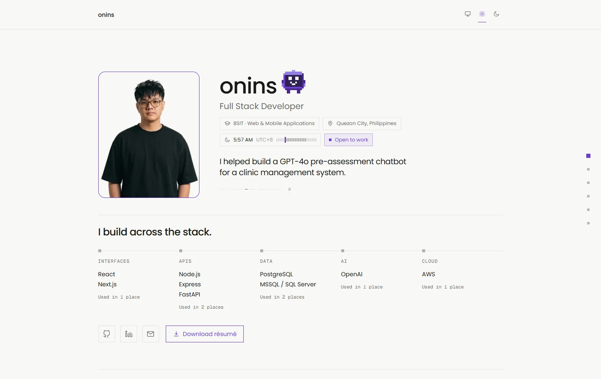

# onins — Portfolio

A one-page portfolio for **Antoniño Bonagua (onins), Full Stack Developer**: a modern résumé redesigned as a website.

**Live site: [onins.dev](https://onins.dev)**

<picture>
  <source media="(prefers-color-scheme: dark)" srcset="design/screenshots/hero-dark.webp">
  
</picture>

## What it is

Six sections on a single page: introduction, experience, projects, certifications, tech stack and contact. It reads like a résumé first, and the page design stays out of the way: editorial type, hairline rules, one accent color, and almost no cards.

- **Pixel-art guide.** A small 14×14 pixel cube that lives beside the name. Click it for a menu, and it flies you to a section. It also comments on the page now and then. Everything it says is generated from the same content the page shows, never repeats a line until it has run through the pool, and it can't claim anything the page doesn't.
- **Tech stack matrix.** Technologies grouped by layer, against projects and roles. Select a project or role to see only what it used.
- **Light, dark and system themes**, applied before first paint so there is no flash.
- **Accessible by default.** Semantic landmarks, a skip link, visible focus states, labelled disclosures, and every animation respects `prefers-reduced-motion`.
- **A contact form that keeps the email address private.** The form is a Server Action validated with Zod and sent through the Mailtrap API. The public email address is never in the source, the HTML or the JavaScript bundle; the server hands it over on a visitor's first hover, focus or touch.
- **Search and sharing.** Metadata, a generated Open Graph image, sitemap, `robots.txt` and `Person` / `WebSite` structured data, all built only from facts already on the page.

## Built with

| | |
| --- | --- |
| Framework | [Next.js](https://nextjs.org) 16 (App Router), React 19 |
| Language | TypeScript 5 (strict) |
| Styling | Tailwind CSS v4 (CSS-first config, no `tailwind.config`) |
| Validation | [Zod](https://zod.dev) 4 |
| Email | [Mailtrap](https://mailtrap.io) REST API through `fetch` (no email SDK) |
| Tooling | ESLint 9 (flat config), npm |

There is no database, CMS, component library or state-management library. The site is static content plus the Server Actions behind the contact form.

## Project structure

```text
src/
  app/            routes, layout, globals.css, the contact Server Action, metadata files
  components/     assistant/ (the guide), contact/, hero/, sections/, layout/, shared/
  content/        all facts shown on the site, one typed file per domain
  lib/            site config, contact module, the guide's logic (lib/assistant/)
public/           portrait, certificate badges, project preview, résumé PDF
design/           DESIGN.md (the design spec) and README screenshots
```

All content lives in [`src/content/`](src/content) (`profile`, `experience`, `projects`, `certifications`, `skills`, `links`) and components only read from it. Nothing is invented: anything not yet supplied is omitted or shown as a clearly marked placeholder.

## Getting started

Requires Node.js 20.9 or newer.

```bash
npm install
npm run dev        # http://localhost:3000
```

| Script | |
| --- | --- |
| `npm run dev` | Dev server |
| `npm run build` / `npm run start` | Production build / serve it |
| `npm run lint` | ESLint |
| `npm run typecheck` | `next typegen` + `tsc --noEmit` |

There is no test runner yet.

### Editing content

| To change | Do this |
| --- | --- |
| Text, projects, experience, certifications | Edit the matching file in `src/content/`. |
| Résumé | Replace `public/Bonagua_Antonino_Resume-Public.pdf`, keeping the filename (set by `resumeFile` in `src/content/profile.ts`). |
| Portrait | Replace the two files in `public/profile/` and update `portrait` in `src/content/profile.ts`. |
| Certificate badges | Images are in `public/badges/`; set each `badge` and `credentialUrl` in `src/content/certifications.ts`. |
| Project preview | Add the image to `public/projects/` and set `preview` (with `width` and `height`) on the project. |

### Environment variables

Set these in your host's settings, or in a git-ignored `.env.local` for development. Never commit them. Only `NEXT_PUBLIC_SITE_URL` is public; the rest are server-only and must never get a `NEXT_PUBLIC_` prefix.

| Variable | Needed for | Purpose |
| --- | --- | --- |
| `MAILTRAP_API_KEY` | contact form | A Mailtrap API token. Use a Sending token for real delivery, or a Sandbox token with `MAILTRAP_INBOX_ID` for testing. |
| `MAILTRAP_INBOX_ID` | testing only | Numeric ID of a Sandbox inbox. When set, messages land in that inbox instead of being delivered. Leave unset in production. |
| `CONTACT_TO_EMAIL` | contact form | Where form messages are delivered. |
| `CONTACT_FROM_EMAIL` | live sending | Sender shown on messages, such as `Portfolio <address@your-domain.com>`, on a domain verified in Mailtrap. |
| `CONTACT_PUBLIC_EMAIL` | email links | The address visitors see. Use a dedicated address, not a personal one. Without it, the email options say they are unavailable. |
| `NEXT_PUBLIC_SITE_URL` | canonical URLs | The site's public address, for example `https://onins.dev`. Drives the canonical URL, sitemap and structured data. On Vercel it falls back to the production domain Vercel provides. |

In production, without a Mailtrap key, a recipient and a valid sender, the form tells visitors it is unavailable. In development the message is logged to the server console instead.

## Deploying

Set up for [Vercel](https://vercel.com): import the repository with the Next.js preset (the default build settings are correct), add the variables above under **Project Settings → Environment Variables**, and redeploy after changing any of them. `NEXT_PUBLIC_SITE_URL` is read at build time. Set `CONTACT_PUBLIC_EMAIL` before the first deploy.

## Project docs and workflow

- [`design/DESIGN.md`](design/DESIGN.md) is the design spec: tokens, layout, motion and how the guide behaves.
- [`AGENTS.md`](AGENTS.md) and [`CLAUDE.md`](CLAUDE.md) hold the working rules for AI coding assistants used on this repository: stack, content, security and verification rules.
- Git-flow: day-to-day work goes on `feature/*` and `fix/*` branches off `develop`, and releases are merged into `main`.
